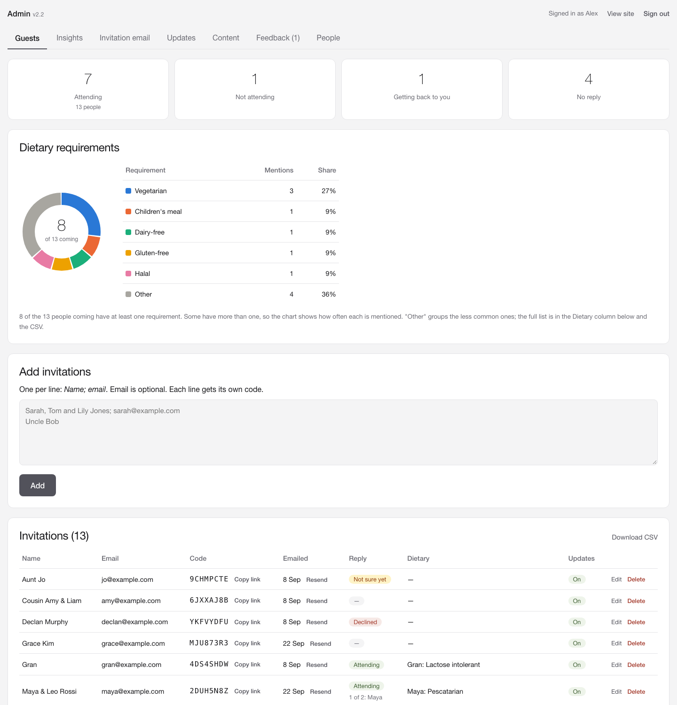
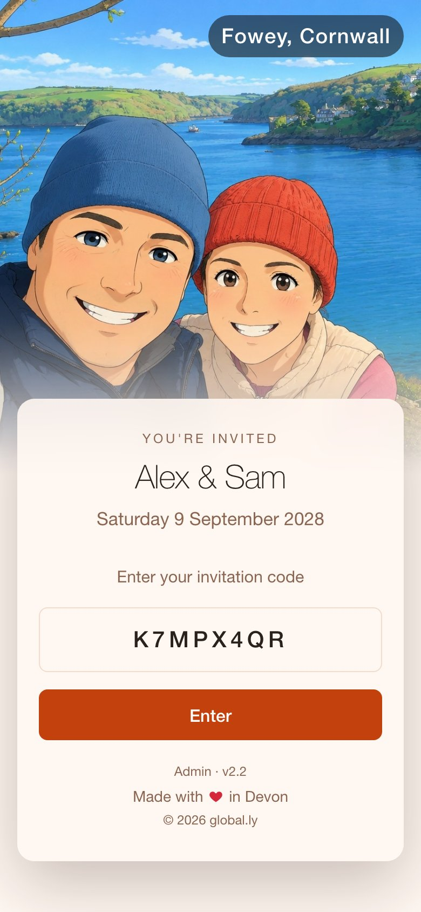
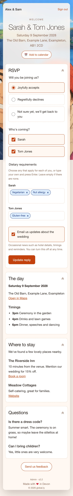
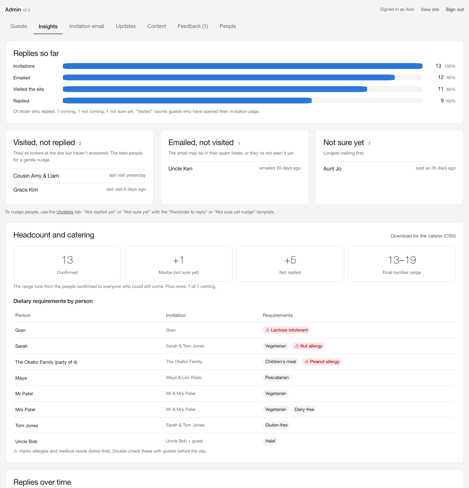

# Joyfully Accepts

[](https://github.com/codeglobally/joyfully-accepts/releases)
[](https://github.com/codeglobally/joyfully-accepts/actions/workflows/tests.yml)
[](SECURITY.md)
[](#accessibility)
[](https://www.php.net/)
[](LICENSE)

A small, self-hosted wedding website with private invitations and RSVPs. Each guest gets an 8-character code (or a link with it built in). Entering it opens their own invitation page, where they reply, choose dietary requirements and see the details you add. You run everything from a simple admin area.

It's plain PHP with a SQLite database: no frameworks, no build step, no external services. It runs on almost any shared hosting (cPanel and similar), and on your own computer for testing.


<details>
<summary><strong>More screenshots</strong>: the invitation page, phones and the admin area</summary>

<br>

| Invitation page | Admin: guests |
|---|---|
|  | <a href="docs/screenshots/admin-guests.png"></a> |

| Home on a phone | Invitation on a phone | Admin: insights |
|---|---|---|
|  |  | <a href="docs/screenshots/admin-insights.png"></a> |

</details>

*Shown with made-up names, date, venue and guests. Out of the box the site uses a built-in sample photo until you add your own.*

## Features

**For guests**
- **Nine languages:** English, Español, Deutsch, Français, العربية (right to left), 简体中文, 繁體中文, Te Reo Māori and Cymraeg. Each guest gets their browser's language on their first visit, can switch in the footer, and keeps it, emails included. See [Languages](#languages).
- Code entry page with your photo and names. The date stays hidden until a guest enters their code (or show it with `DATE_ON_HOME_PAGE`). The code fills in automatically from the invitation link.
- RSVP: *Joyfully accepts / Regretfully declines / Not sure yet*, choosing **who's coming** per person ("Sarah & Tom Jones" gets a tick box each), or a number for "The Smith Family".
- Dietary requirements per person, picked from a list or typed in, shown as removable chips.
- Content sections you write (the day, where to stay, travel, FAQs…), collapsible, with each guest's open/closed choice remembered.
- **Add to calendar** (Apple/Outlook file with reminders, Google Calendar, Outlook.com).
- Opt in or out of update emails, and a feedback box.
- Works well on phones, tablets and desktops.

**For you (admin)**
- **Guests:** add invitations in bulk (`Name; email` per line) or by uploading a spreadsheet saved as CSV, edit, copy links, and download a CSV. Tick several invitations to send (or resend) them, or delete them, together. A couple can have an email address each, and both get the invitation and updates. Summary counts, plus a dietary requirements donut chart.
- **Insights:** RSVP funnel (invited → emailed → visited → replied), who to nudge, headcount range, caterer-ready dietary list with allergies flagged (CSV), and replies over time.
- **Invitation email:** styled HTML email with your photo, preview, test send, and send to everyone not yet emailed.
- **Updates:** email news to everyone or a group (coming, not replied…), with templates, one-click unsubscribe and a history.
- **Content:** add, edit, reorder, show or hide guest-page sections with simple formatting (bold, italic, headings, lists, links, text sizes) and preview.
- **Feedback** inbox, with optional emails to each admin when a guest sends a message (replies go straight to the guest; the owner can switch them on or off for anyone on the People tab), and **People**: extra admin logins (e.g. your partner) via emailed setup links, with forgot-password.

## Requirements

- PHP 7.4 or newer with PDO SQLite (standard on most hosts). GD is optional: it lets the site sample colours from your photo.
- Apache or LiteSpeed (for the included `.htaccess` rules). On nginx, keep `private/` outside the web root (recommended anyway).
- HTTPS (free Let's Encrypt certificates come with most hosting).

## Quick start (on your computer)

```bash
cp private/config.example.php private/config.php
php -S localhost:8080 -t public_html tests/router.php
```

Open http://localhost:8080. Edit `private/config.php` to set your names, date, venue and an admin password, then sign in at http://localhost:8080/admin.php with username `admin`.

When running locally, emails aren't sent. They're written to `private/data/mail.log` instead. PHP caches files briefly, so wait a couple of seconds after editing before reloading.

## Making it yours

All settings live in `private/config.php`. See `private/config.example.php` for every option, with examples.

- **Names, date, venue, site address and admin password:** the first few settings.
- **Photo:** put your photo in `public_html/assets/photos/` and set `PHOTO`. The layout adapts to any photo's shape, and the soft colour wash that continues past the photo is sampled from its edges automatically. Without a photo of your own, a sample landscape is used. Set `PHOTO` to `''` for a plain page. Optionally set `PHOTO_EMAIL` to a smaller copy for emails.
- **Caption over the photo** (e.g. where it was taken): `PHOTO_CAPTION`. Each part can be plain text or a hidden link.
- **Easter eggs:** `PHOTO_HOTSPOTS` puts invisible links over parts of the photo (e.g. the place you got engaged). They're positioned as fractions of the photo, so they line up at every screen size, and are left out where that part of the photo is cropped (e.g. on phones).
- **Footer:** `MADE_IN` adds "Made with ♥ in …" (optionally a hidden link). The footer also credits the project ("© global.ly", linking here).
- **Dietary options:** the list guests pick from is `DIETARY_OPTIONS` in `private/lib.php`.
- **Colours:** CSS variables at the top of `public_html/assets/style.css`.

Look-and-feel settings can also go in a separate `private/site.php`, which `deploy.sh` uploads (unlike `config.php`), so you can tweak them without touching the server by hand.

## Languages

The guest pages, emails and admin area come in English, Español, Deutsch, Français, العربية, 简体中文, 繁體中文, Te Reo Māori and Cymraeg.

- **Guests** get their browser's language on their first visit (falling back to the site's), can change it from the globe in the footer, and keep it after that. It's saved on their invitation, so update emails arrive in it too. The first invitation email goes in the site's language, unless you've set a guest's language yourself (when editing an invitation, or with a *Language* column in your CSV).
- **Your own wording** can be translated as well: each guest-page section, the invitation email and tagline, and each update have a version per language. Anything you haven't translated falls back to your main version; built-in text you haven't changed is already translated.
- **Each admin** picks the language of the admin area, and of emails sent to them, under avatar menu → **Your account**.
- **Settings** (in `config.php`): `SITE_LANGUAGE` is the language you write in; `LANGUAGES` is the list guests can choose from (`['en']` for English only); `ARABIC_DIGITS` set to `'eastern'` shows Arabic numbers as ٠-٩.
- **Drafts:** everything other than English is a first draft. If something reads wrongly, please [suggest a correction](https://github.com/codeglobally/joyfully-accepts/issues/new?template=translation.yml), or [ask for another language](https://github.com/codeglobally/joyfully-accepts/issues/new?template=new_language.yml).

**Guests in mainland China:** Google services are blocked there, so the *Google Calendar* option won't open for them; the Apple/Outlook calendar file works everywhere. The site itself uses no Google fonts or scripts, so it loads normally. If a section links to Google Maps, consider adding an Apple Maps or Baidu/Amap link too.

## Putting it online

1. **Upload** (FTP, SFTP or your host's file manager), including hidden `.htaccess` files:
   - the **contents** of `public_html/` into your web root (often `public_html` or `www`)
   - the `private/` folder **next to** the web root, not inside it. If your host only gives you the web root, put it inside; the pages find it either way and `.htaccess` blocks it.
2. Create `private/config.php` on the server (copy the example and fill it in). Make sure `private/data/` is writable by the web server.
3. Turn on HTTPS, then visit `/admin.php` and sign in as `admin`.
4. Check that `https://yourdomain/config.php` and `https://yourdomain/private/config.php` show "Forbidden" or "Not Found".

### One-command updates (cPanel)

`deploy.sh` uploads a new version through the cPanel API. It never uploads `private/config.php` or your database, and it backs up the live site first (to `~/wedding-backups/` on the server, including config and database; to roll back, extract a backup in File Manager).

1. In cPanel, open **Security → Manage API Tokens** and create a token (give it an expiry date).
2. Run `./deploy.sh --setup` and enter your domain, cPanel username (the account name, not an email address) and the token. They're stored in `~/.config/wedding-deploy/`, readable only by you. The token is passed to curl via a temporary file, never on the command line.
3. Run `./deploy.sh --check` to test the connection, then `./deploy.sh` to deploy.

Bump `SITE_VERSION` in `private/lib.php` (and the version badge at the top of this README) for each release. It's shown in the footer, refreshes browser caches, and lets the script confirm the new version is live. A cPanel token can do anything in your hosting account, so revoke it when you're done.

## Sending emails that don't land in spam

Emails go out through your host's mail system:
- Set the **From address** (admin → Invitation email) to a real mailbox on your domain.
- Make sure your domain has **SPF**, **DKIM** and **DMARC** DNS records. A simple DMARC record is a TXT record named `_dmarc` with `v=DMARC1; p=none;`.
- If your domain uses your registrar's nameservers rather than your host's, add DNS records at the registrar. Records added in your host's DNS editor won't be seen.
- Send yourself a test first and mark it "Not junk" if needed. Most shared hosts limit sending to a few hundred emails an hour.

## Admin guide

- **Adding guests:** one invitation per line, as `Name; email` (email optional). One line per household (`Sarah, Tom and Lily Jones; sarah@example.com`). If a couple have an email each, add both (`Ali & Jo Khan; ali@example.com; jo@example.com`): each address gets its own copy of every email. To add a whole list at once, upload a spreadsheet saved as CSV, with the name in the first column and any email addresses in the next columns (headings like *Name*, *Email*, *Email 2* are fine, and other columns are ignored). Names already on the list are skipped, so you can upload an updated file safely. The name decides the RSVP's tick boxes: separate people with `&`, `,` or `and`, add a plus-one with `+ guest`, and use "Family" for an unknown number. The edit form shows how a name is being split.
- **Logins:** the owner signs in as `admin` with `ADMIN_PASSWORD`, which can't be reset by email, so there's always a way in. Add others on the **People** tab: they get an emailed (or copied) one-time setup link, valid 7 days, and choose their own password. They can use every tab except People, and **Forgot password?** emails them a reset link.
- **Your account:** open the account menu (your initials, top right) and choose **Your account**. Add your email address and tick **Email me when a guest sends a message** to hear about feedback as it arrives; replying to that email answers the guest directly when their invitation has an email address. Other admins need their current password to change their email address, since it's also used for password resets.
- **Passkeys:** on the same **Your account** page. Anyone can add a passkey there (Face ID, a fingerprint, a device PIN, or a password manager). Once you have one, it's required: sign in with **Sign in with a passkey**, or with your password and then the passkey. Add one on each device you use, or use a password manager that syncs them. If another admin loses theirs, the owner's **Reset password** on the People tab also clears their passkeys. If the owner loses theirs, set `PASSKEY_RECOVERY = true` in `config.php`, sign in with just the password, remove the old passkey and add a new one, then set it back to `false`. Passkeys work on the live site over HTTPS (the address in `SITE_URL`) and on `localhost`.
- **Content formatting:** blank line = new paragraph, `## ` = subheading, `- ` = bullet, `**bold**`, `*italic*`, `[text](https://…)` = link, and `[large]…[/large]` (also `small` and `xlarge`) = text size. The toolbar adds these for you.
- **Greetings:** choose whether guests are greeted by their full name ("Sarah, Tom and Lily Jones") or first names only ("Sarah, Tom and Lily"), on the Guests tab. Surnames the site has found are shown in **bold** in the guest list. It understands titles ("Mr & Mrs Smith" keeps the surname), relations ("Uncle Bob" is a first name), family names, and surnames like "van der Berg" or "Ó Briain". Any invitation can override the choice, or have its own greeting typed in, from its edit form. The greeting is used for `{name}` in emails and the welcome on the guest's page.
- **Tagline:** the short line above your names on the code-entry page and at the top of the invitation email ("You're invited" unless you change it) is set on the **Invitation email** tab. Try *Save the date* or *Join us*.
- **Email placeholders:** `{name}` (the guest's greeting), `{link}` and `{code}` are filled in for each guest. In emails, the link appears as a button.

## Security

- **Codes:** 31 characters × 8 positions (about 850 billion combinations). Each connection gets 10 wrong guesses per 15 minutes (IPv6 counted per /64), shared with admin sign-ins.
- **Sessions:** a new session ID and form token at sign-in. Cookies are HttpOnly, SameSite=Lax and Secure over HTTPS. Admin sessions end after 2 hours idle or 12 hours in all, and straight away if that person is removed or their password changes (including a new `ADMIN_PASSWORD` in config.php).
- **Forms:** CSRF tokens everywhere, input read as plain text, and prepared SQL statements.
- **Output:** HTML-escaped everywhere, a strict Content Security Policy (only the site's own scripts and styles), no framing, HSTS, Permissions-Policy and cross-origin isolation headers, and spreadsheet-formula-safe CSV exports.
- **Passwords and passkeys:** at least 12 characters, and extra admins' passwords are bcrypt-hashed. Setup and reset links are stored only as hashes and are single-use. Admins can add passkeys, which are then required (on their own, or after the password), so a stolen password alone can't get in.
- **Files:** config, code and the database live outside the web root, with `.htaccess` blocking them if they ever end up inside it. Errors go to the server log, never the page. Pages carry `noindex`.
- **Privacy:** no third-party analytics, fonts or trackers. Visits and insights stay in your own database.

**Known limits:** anyone with a guest's link can RSVP as that guest (the trade-off for one-click links). `ADMIN_PASSWORD` is stored as plain text in `private/config.php`, so keep that file private and the password unique. Don't put anything truly sensitive on the guest pages.

### Security checks

[SECURITY.md](SECURITY.md) maps the site against the OWASP Top 10 and ASVS level 1, and explains how to report a vulnerability privately. On every push, GitHub Actions runs:
- **Psalm taint analysis**: traces request data to HTML, SQL, headers, files and shell commands, and fails on anything unescaped.
- **OWASP ZAP baseline scan**: crawls a test copy and checks headers, cookies, CSRF tokens and information leaks.

The reference install scores **A+** on both [Mozilla Observatory](https://developer.mozilla.org/en-US/observatory) (headers) and [SSL Labs](https://www.ssllabs.com/ssltest/) (TLS). It's worth testing your own site too, since TLS depends on your host. To run the taint analysis yourself (needs [Psalm](https://psalm.dev) 6):

```bash
psalm --taint-analysis
```

## Accessibility

The guest pages and the whole admin area were audited against **WCAG 2.1 level AA** with [axe-core](https://github.com/dequelabs/axe-core) 4.10 (the engine behind most accessibility checkers), on 13 pages and states at desktop and phone sizes, with **no issues found**. Alongside that:
- Text and control colours meet AA contrast (4.5:1 for text). The photo caption has its own backing so it stays readable over any photo.
- Everything works by keyboard, with visible focus, including the dietary picker and collapsible sections.
- Form fields have labels, images and icon buttons have text alternatives, and charts come with a table version.
- Respects "reduce motion" and "reduce transparency" settings, and works without JavaScript (the dietary picker falls back to a plain list).

Automated tools can't catch everything, so if you hit a barrier, please [report it](https://github.com/codeglobally/joyfully-accepts/issues/new?template=accessibility.yml). Accessibility reports are given priority.

## Running the tests

```bash
php tests/run.php
```

That runs the unit tests (name parsing, codes, safe formatting, CSV safety, dietary handling, calendar files, logins). To include end-to-end checks against a running copy of the site (sign-in with a code, RSVP, security headers, admin protection):

```bash
WEDDING_CONFIG=$PWD/tests/config.php WEDDING_TEST_DB=/tmp/e2e.sqlite php -S localhost:8097 -t public_html tests/router.php &
WEDDING_CONFIG=$PWD/tests/config.php WEDDING_TEST_DB=/tmp/e2e.sqlite php tests/run.php --http=http://localhost:8097
```

GitHub Actions runs both on PHP 7.4, 8.1, 8.3 and 8.4 for every push and pull request.

## Project layout

```
public_html/            Everything a browser can reach
  index.php             Code entry (home page)
  guest.php             A guest's invitation page and RSVP
  admin.php             Admin area (all tabs)
  calendar.php          "Add to calendar" file
  unsubscribe.php       Stop / restart update emails
  404.php               "Page not found", in the site's style
  theme.css.php         Styles worked out from your photo and settings
  assets/               Stylesheet, scripts, sample photo; photos/ for yours
private/                Never served to browsers
  config.example.php    Copy to config.php
  defaults.php          Defaults for optional settings
  lib.php               Shared code
  mailer.php            Invitation emails
  notify.php            Update emails
  content.php           Guest-page sections
  users.php             Admin logins
  passkeys.php          Passkey sign-in (WebAuthn), with no libraries
  insights.php          Insights tab
  calendar.php          Calendar file and links
  photo.php             Photo shape and edge colours
  i18n.php              Languages: choosing one, phrases, plurals and dates
  lang/                 Guest phrases per language; lang/admin/ for the admin area
  data/                 SQLite database (created automatically)
tests/                  Automated tests (run.php) and their settings
docs/screenshots/       Images for this README
.github/               Tests and security scans, issue and pull request templates
.zap/rules.tsv          Which ZAP scan findings fail the build
psalm.xml               Settings for the Psalm taint analysis
SECURITY.md             OWASP review and how to report a vulnerability
CHANGELOG.md            What changed in each version
CONTRIBUTING.md         How to help, run it locally and send changes
CODE_OF_CONDUCT.md      How we treat each other, and how to report problems
deploy.sh               One-command deploy to cPanel hosting
```

## Feedback and contributing

- **Used it for your wedding?** [Tell us how it went](https://github.com/codeglobally/joyfully-accepts/issues/new?template=feedback.yml). It's the best way to improve it.
- **Found a bug?** [Report it](https://github.com/codeglobally/joyfully-accepts/issues/new?template=bug_report.yml).
- **Speak one of the languages?** [Correct a translation](https://github.com/codeglobally/joyfully-accepts/issues/new?template=translation.yml) or [ask for a new one](https://github.com/codeglobally/joyfully-accepts/issues/new?template=new_language.yml).
- **Have an idea?** [Suggest it](https://github.com/codeglobally/joyfully-accepts/issues/new?template=feature_request.yml).
- **Found a security problem?** Please report it [privately](https://github.com/codeglobally/joyfully-accepts/security/advisories/new), never in a public issue. See [SECURITY.md](SECURITY.md).

Pull requests are open to collaborators only, but suggested fixes are welcome in an issue, and you're free to fork it for your own wedding. See [CONTRIBUTING.md](CONTRIBUTING.md) for how to run your own copy and the project's aims. Everyone taking part follows the [code of conduct](CODE_OF_CONDUCT.md).

## Licence

MIT. See [LICENSE](LICENSE). The sample photo is generated by the project and free to use.
